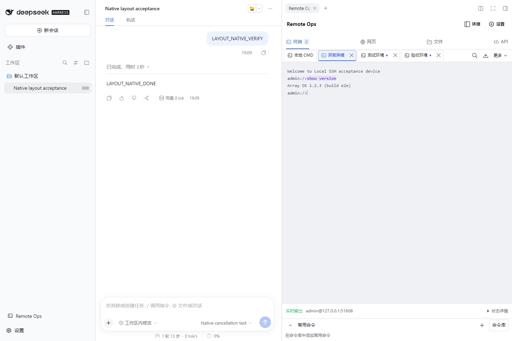
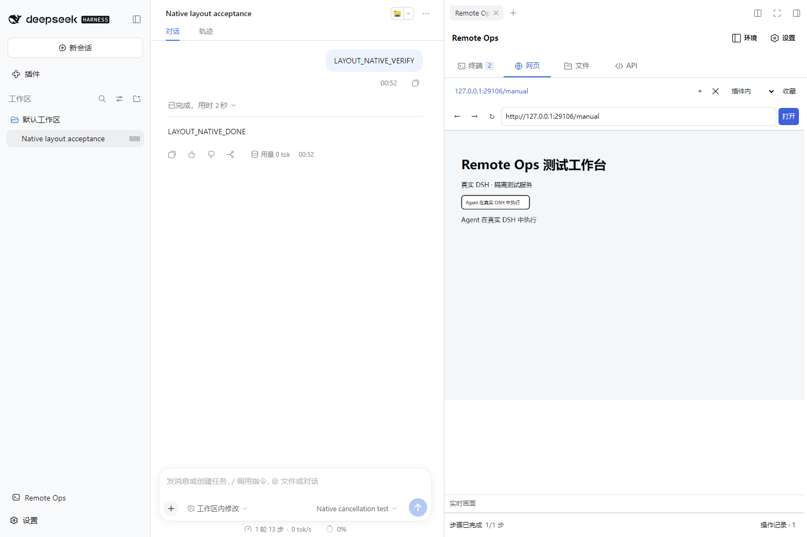
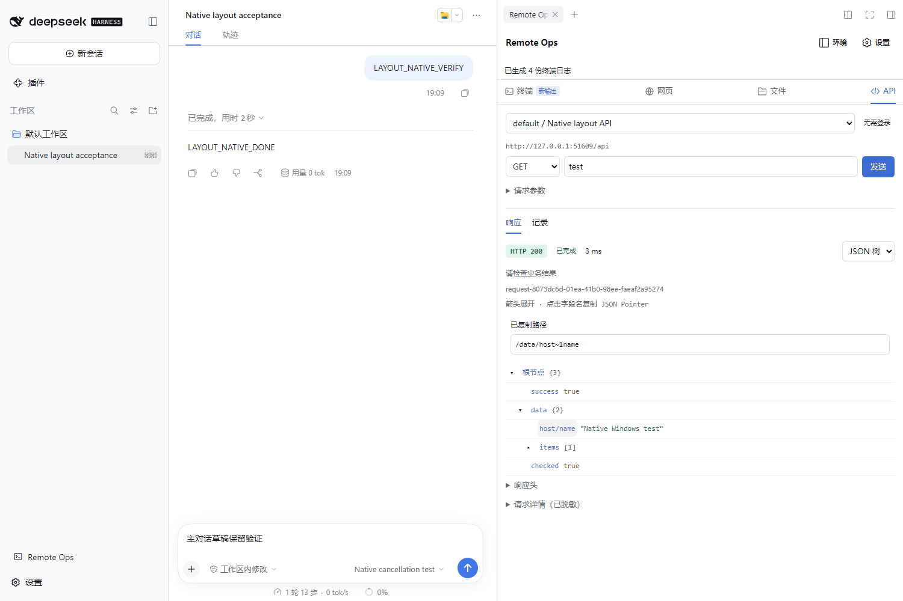

# DSH Remote Ops

`@dsh/remote-ops` is a DeepSeek Harness plugin for terminal, web, Windows desktop and RESTful API operations. Users and Agents share a workspace for commands, application windows, webpages, file transfers and business API requests.

## See the workspace

**Terminal** — Local CMD and SSH share one session strip. The example runs a version command on a local SSH test service.

[](docs/images/remote-ops/terminal.png)

**Web** — Open a URL and operate the same visible page as the Agent.

[](docs/images/remote-ops/browser.png)

**API** — Inspect HTTP status, business results and a collapsible JSON response; click a field to copy its JSON Pointer.

[](docs/images/remote-ops/api.png)

These screenshots show v0.9.2 installed in real DSH 0.2.0-rc.2; the installed package matches the official Release SHA256. A deterministic test provider drives real tools against isolated local SSH, web and API services.

## Windows desktop operations

The **桌面** workspace shows real Windows application windows. Connect the DSH Windows host or a saved Windows SSH environment, launch software, inspect UIA controls, fill fields, click buttons and verify outcomes. Users can operate the same window; native DSH cancellation stops later steps. Export this conversation's desktop records and last captured windows as a ZIP.

The tgz includes the pinned worker and dependencies plus the native `remote-ops-desktop` skill. Use a logged-on, unlocked Windows 11 or Windows Server Desktop Experience session; the SSH account must match that desktop user. Hot reload waits for active desktop work and retains connections and logs. See the [Windows desktop guide](integrations/dsh-remote-ops/DESKTOP.md).

## Hot reload after updates

Starting with v0.11.0, **设置 → 更新 → 检查并更新** downloads, verifies and installs a newer release, then automatically applies it when work is idle. DSH keeps running. The update view explains waits for conversation activity, terminal waits and independent commands, transfers, browser jobs/runtime installation, and API requests. Browser uploads defer reload until the whole batch finishes or is cancelled, including the gaps between file requests.

The handoff preserves the current conversation and draft, saved settings, live terminal/browser connections, terminal logs, and API authentication and records. No command or request is replayed. Output silence is not treated as proof that a manual terminal command finished: its connection is retained. New connections use the new implementation; existing transports retain the implementation they were created with.

A failed startup restores the previous runtime and exposes **重试应用已安装版本** (retry activation). Running and installed versions remain distinct. Missing host reload APIs or an incompatible runtime state format produce an explicit restart requirement.

**The first upgrade from v0.10.x or earlier still needs one DSH restart to load this capability.** Subsequent compatible updates from the plugin dialog apply automatically. After installing through the CLI or host plugin manager, use the plugin's retry-activation button. Refreshing the browser alone does not update the backend. See the [v0.11.0 acceptance record](docs/testing/dsh-remote-ops-v0.11.0-acceptance.md).

## SSH tab status and close all

The terminal strip exposes **全部关闭** (close all). It closes the current conversation's SSH tabs and their connections captured when clicked, preserving local CMD, saved environments and other conversations. Live connections or known running commands receive one combined confirmation with an active-operation count; disconnected tabs without running commands clear immediately. Failed closures remain visible with a reason. Connections opened during confirmation are excluded from that selection.

| Indicator | Meaning |
| --- | --- |
| Amber ring | Waiting for output, executing an independent command or closing; hover for the specific state and whether the Agent initiated it |
| Green dot | Connected; not proof that a command finished or a business operation succeeded |
| Hollow gray dot | Disconnected without a known running command; received output is retained for inspection or export |

Shapes, text and accessible descriptions accompany the colors; blue still marks the selected tab. Amber is informational and human input remains available. Ordinary keystrokes and new output are not treated as reliably timed command executions.

Closing cancels associated waits and independent commands and requests SSH channel shutdown. Remote process termination remains unconfirmed; commands are not replayed. Closing tabs does not erase retained logs, which remain available through log tools or **更多 → 一键打包本会话全部日志** within the retention limits.

## Windows OpenSSH

Windows desktop and Server use the existing SSH environment, terminal, file and log workspaces. Choose the target platform and server-default, CMD, Windows PowerShell 5.1 or an installed PowerShell 7 in **环境 → SSH**. **测试** reports authentication, detected system, PTY, SFTP and the host fingerprint separately.

`remote_environment_create/update/test` manages and diagnoses targets. `remote_command_execute` accepts a Windows shell, literal working directory and named PowerShell parameters, and returns exit status and separate error output. Windows independent commands authenticate a separate SSH connection while preserving the visible terminal. SFTP handles drive paths, Unicode and spaces; existing file and multi-terminal log tools remain available.

The package includes the native DSH `remote-ops-windows` skill. See the [Windows guide](integrations/dsh-remote-ops/WINDOWS.md) and [verification matrix](docs/testing/dsh-remote-ops-v0.10.2-acceptance.md). No Agent modification is required.

## Workspace tabs

Terminal, Web, Files and API now form a compact left-aligned group. The blue selection line spans the complete tab button. Narrow panels use smaller padding while retaining labels, background activity badges and arrow / Home / End navigation. Switching preserves workspace contents.

The [staged Windows proposal](docs/proposals/windows-remote-implementation.md) also describes future WinRM work.

## Terminal layout and request diagnostics

- Session tabs, close all, search and the current TXT download share one row, with approximately 32px desktop tabs. All-log ZIP export lives under **更多**; the bottom status bar shows the path, quick commands remain below, and **设置 → 终端** controls the active SSH size.
- Error headings distinguish state refresh, terminal output refresh and plugin update failures. Expand **错误详情** for the request method, redacted URL, HTTP status, stage, timestamp and bounded response preview. Network failures explicitly say that no HTTP response was received.
- Update failures identify the version manifest, SHA256 file or archive, including the actual failed URL. Upstream HTTP status and the plugin endpoint status are labeled separately.
- The same background refresh failure is automatically announced once per DSH/plugin runtime. Dismissing it, switching workspaces or refreshing the page does not repeatedly reopen it. Background retries continue; explicit **刷新状态** still reports its result. Recovery clears the corresponding state error; a new backend runtime enables notifications again.
- Diagnostics redact URL query values and common password, Token, Cookie and Authorization fields. They do not collect request bodies or headers.

For a 404, first identify whether the failed URL is `/api/dsh-remote-ops/state` or an update-source file, then check plugin loading, service routing or the release directory accordingly. Version checks remain manual.

## Workspace layout

- All four workspaces share one **设置** entry with general, terminal, browser and update categories. **环境** manages SSH and API environments together, retaining their separate forms and credentials.
- Local CMD and SSH use one consistent terminal tab strip, with a filled background, border and bold text for the active tab. Arrow keys switch terminals. **返回工作区** (back to workspace) stays at the top left of both SSH and API environment management while scrolling, preserving the active terminal or request draft when returning. The terminal row contains close all, search, current TXT download and **更多** (more). Quick commands start as a compact strip; expand it or open **命令库** to manage saved commands.
- Workspace tabs show unread terminal output, file transfers and browser execution. Viewing the corresponding terminal clears its unread indicator. Transfers show a percentage only when the total is known reliably.
- API results have **响应 / 记录** tabs. Expand JSON nodes and click a field name to copy its JSON Pointer, with selectable text when clipboard access fails. HTTP status uses both color and text; 2xx also says **请检查业务结果**. Large trees render in batches and retain a raw view.
- Workspace/settings switches preserve terminal, browser and API state. Background work continues while hidden browser views suspend frame requests.

## Manual intranet HTTP/HTTPS updates

Current version: [v0.11.0](https://github.com/Ssshake1996/myterm/releases/tag/dsh-remote-ops-v0.11.0). See the [installation and UI acceptance scope](docs/testing/dsh-remote-ops-v0.10.2-acceptance.md).

Open Remote Ops → **设置 → 更新**, save a source, then choose **仅检查版本** (check only) or **检查并更新** (check and install). Choose the default GitHub Release source or an intranet HTTP/HTTPS URL. Clicking a button starts the check; a newer stable version can then be installed. Running and installed versions are shown separately. Compatible updates automatically activate when ongoing work finishes; the view reports the waiting reason and the resulting running version.

Keep `latest.json`, `dsh-remote-ops-v0.12.0.tgz` and `SHA256SUMS-dsh-remote-ops-v0.12.0.txt` in the feed directory. Generate the manifest from the unchanged official release pair:

```sh
node integrations/dsh-remote-ops/scripts/create-update-manifest.mjs ./release/dsh-remote-ops-v0.12.0.tgz
```

The installed package also includes `scripts/create-update-manifest.mjs`. An optional second argument chooses an existing parent directory's `latest.json`, allowing version subdirectories. The script verifies checksum and package identity, refuses a lower version, and writes the manifest atomically. Upload the tgz/checksum first and publish the manifest last. Serve the directory over HTTP/HTTPS. GitHub Release provides the tgz and SHA256 checksum file.

- HTTP(S): use a directly readable directory URL or `latest.json` URL containing the scheme, host and path. All files and redirects must remain on that origin; the server must allow the DSH host to download them directly. Trust internal HTTPS certificates in the DSH Node process.
- Dependencies use the DSH registry, proxy and build-approval configuration. Provide an accessible internal npm registry when needed. Chromium can be installed on demand.

Verified packages are cached on the DSH host and installed by the current profile's native DSH plugin manager. Source settings live in `$DSH_HOME/remote-ops/update-settings.json` and are shared within that DSH home; installation affects the current profile. Installation errors provide a reason and log location. Failed hot reload restores the previous runtime and allows an explicit activation retry. Older installations need one restart after their first upgrade; a full restart does not restore process-local connections or records. The bundled `remote-ops-updates` skill covers configuration, feed generation and diagnostics.

## Saved RESTful environments and execution workspace

- The **API** workspace saves base URLs, groups, common headers, timeout, private CA and login configuration. API targets work without SSH; an optional SSH environment ID links the same device without sharing credentials.
- A single POST login sends username/password as JSON or form and extracts a Token through JSON Pointer or a response header, or stores scoped Cookies. Cookie-to-CSRF-header mapping is supported. Passwords use DSH credentials; configuration stores references. Login sessions are isolated by conversation and remain in memory only.
- UI and Agent requests share visible login/request records, HTTP status, timing, redacted responses, errors and unknown outcomes. Export the current conversation's records as JSON. HTTP 2xx still requires checking the business response.
- The bundled `remote-ops-api` skill guides Agent operations: select a target with `remote_api_environment_list`, manage it with `remote_api_environment_save/delete`, then use exact returned IDs with `remote_api_login`, `remote_api_request` and `remote_api_records`.
- Requests originate on the DSH host. Both `/items` and `items` preserve the base URL's path prefix. No automatic redirects, reauthentication or replay. After a timeout/cancellation with an unknown outcome, query device state before any retry.
- Configuration persists in `$DSH_HOME/remote-ops/api/environments.json`; login state, records and duplicate-ID protection cover only this process's last 100 requests per conversation. Response preview: 128 KiB; request body: 1 MiB. Edits invalidate login; running requests keep their captured target. Switching tabs does not cancel requests.
- Credentials and known authentication values are redacted; business payloads may still contain sensitive data.

## Local CMD commands and directory colors

The terminal uses a [Catppuccin](https://catppuccin.com/palette/)-inspired Latte / Mocha palette following the DSH light/dark theme: purple commands, teal directories and blue files. Light accents are darkened for readable text contrast. Error, warning and success prefixes also receive emphasis; verify outcomes from the actual output. Surrounding plugin controls use host styling.

Commands echoed after a standard prompt now use the same accent, weight and subtle background whether typed manually, sent as a complete Agent command or entered through raw keys. Recognition runs after terminal cursor redraws, so visible edits/backspaces remain readable. No extra command is executed and hidden input is never added to the display.

Standard `dir` rows show directory names in teal and file names in blue, leaving timestamps, sizes and totals unchanged. Existing ANSI colors are retained. Common CMD, PowerShell and `user@host` Shell prompts are recognized; custom prompts and formats without type information, such as `dir /b`, are not guessed. Full-screen applications do not receive these semantic colors. **设置 → 终端** can disable them; copied, searched and exported text stays unchanged.

## Reveal environment passwords on demand

The SSH password field in the environment editor has an eye button. It stays masked by default and resolves the currently effective saved credential only on request. Hiding the password or closing the editor/drawer clears the revealed value. Newly typed passwords can also be shown for checking.

Viewing alone never changes the credential: saving other fields preserves it; typing a replacement updates it. Missing configuration, missing credentials and unavailable providers have clear retry/re-entry messages. Revealed values are not written to browser storage, environment listings, diagnostic records or Agent tool results. The bundled environment-management skill describes the user-facing path.

## Terminal logs

- The download button beside terminal tabs exports the current terminal as UTF-8 TXT. **更多 → 一键打包本会话全部日志** exports all available conversation logs as ZIP, including retained closed SSH records and the shared local terminal. Each ZIP contains separate transcripts and a `manifest.json` with source, time and coverage metadata.
- `remote_terminal_logs`, `remote_terminal_log_read` and `remote_terminal_log_export` provide discovery, raw-cursor pagination and packaging. The export tool returns SHA256 and an absolute download link for the observed trusted DSH browser origin (or null when unavailable; use the toolbar); the Agent need not copy screen text, read every page or run archive commands.
- The bundled `remote-ops-terminal-logs` skill is automatically discoverable through DSH, with `/remote-ops-terminal-logs` also available. The tgz carries both tools and instructions.
- Retention is process memory: 4 MiB per terminal, trimmed to the latest 3 MiB on overflow; closed records share a 16 MiB / 32-record limit. APIs disclose truncation and evictions. History does not survive restart. Hidden/raw input is not logged separately, but secrets printed by programs can still be present.
- A package accepts at most 32 logs / 32 MiB raw output. Download cache is limited to 10 packages / 32 MiB; links expire after one hour, earlier eviction or host restart. Exports freeze current buffers; later output needs a new export. Progress frames are retained as lines, not a replay of a full-screen application. Independent commands and browser activity are separate records.

## Agent environment management

- `remote_environment_update` updates an existing environment selected by ID or name. It changes only supplied non-null fields, preserving identity, credentials and omitted configuration. Invalid fields and duplicate names reject before writing.
- Bundles `remote-ops-environments` alongside the browser skill through DSH's native skill provider, with automatic discovery and `/remote-ops-environments` invocation.
- Existing SSH connections keep their original settings and stay open. New connections use the updated definition. The list's `passwordRef: "configured"` is a display marker; omit it to preserve credentials. Store new passwords through the environment form.
- Agent and frontend share persisted environments. See the [plugin README](integrations/dsh-remote-ops/README.md) for the API and installation contract.

## Interface and interaction

- Terminal, web, files, environments, saved commands and diagnostics share consistent typography, spacing, controls and host-aware light/dark surfaces. Workspace tabs stay at the top; version, diagnostics and comfortable/compact density live under **设置 → 通用**. Updates live under **设置 → 更新**. Density persists in this browser.
- Local CMD and SSH always use the same terminal tab strip, with the address and tools below. The strip scrolls horizontally when needed; arrows and Home/End select a terminal and bring its tab into view.
- The web workspace prioritizes the address and live page. **设置 → 网页** contains engines, Chromium installation, viewport and zoom. **收藏** manages sites and flows; **操作记录** expands below the live page. Returning to the workspace retains the URL draft and current page.
- Switching an open page between embedded and independent display requires confirmation. Cancel dispatches nothing; confirming reloads the page and may lose unsent form content. Switching cannot be submitted repeatedly while pending.
- File batch actions appear after selection. Upload controls match other buttons, and browser uploads show byte progress. Module switches retain selection, drafts and background jobs; completed transfers still use coalesced directory refreshes.

The left action opens the native DSH right sidebar. Human and Agent input is shared; use native conversation cancellation to stop the Agent.

## Browser arguments and on-demand runtime

Browsers run on the DSH host. Install Chromium on demand through the plugin tools or browser settings. Dependency and browser installation requires accessible download sources.

- Independent windows follow the Windows user's default HTTP(S) browser on the DSH host, supporting installed Chrome / Edge with an isolated plugin profile. Embedded mode still defaults to matching Chromium. Each mode has its own engine preference. Explicit saved-site or tool browser choices take precedence. Unsupported/unavailable defaults report an error instead of silently opening Edge. A remote DSH host's default is separate from the client viewing DSH.
- Prefer an action array for `steps`. Single action objects, a sole `{steps:[...]}` envelope and JSON-encoded versions are accepted. Prefer `{kind,value,name?,frame?}` locator objects for `target`; JSON-encoded locator objects and CSS/XPath strings (`css=#id`, `xpath=//button`, `#id`, `//button`) are accepted. All steps normalize and validate before dispatch. Equivalent requests deduplicate under the same `requestId`.
- For missing Chromium, call `remote_browser_runtime` with `action: "status"`, then `action: "install"` if needed. Poll `status` until the required mode is ready before opening a page. The plugin's installed Playwright CLI downloads its matching Chromium and Headless Shell. The settings button uses the same installer. Network access is required; configure `HTTPS_PROXY`, `PLAYWRIGHT_DOWNLOAD_HOST` or `PLAYWRIGHT_DOWNLOAD_CONNECTION_TIMEOUT` before starting DSH if needed. Complete matching runtimes are reused and login profiles/sites/flows retained.
- `BROWSER_STEP_INVALID` identifies the field, accepted format and no-dispatch status. Correct the argument instead of repeating an unchanged invalid call; preflight rejection does not reserve the request ID. The bundled `remote-ops-browser` skill describes argument formats and recovery steps. Restart DSH and refresh its webpage after upgrading; verify the current version in **更多设置**.

## Workspaces and interaction

- **终端 / 网页 / 文件 / API** workspace tabs support arrows and Home/End. Environment management opens inside the panel; **设置 → 通用** contains diagnostics and refresh, while **设置 → 更新** handles updates. The native DSH right Sidebar and the main conversation are preserved.
- The module, selected terminal and environment filter recover per conversation after closing/reopening or refreshing. File path/sort/scroll/bookmarks keep their existing persistence. File filters, path drafts and reconciled selections survive module/panel switches within one webpage; a full reload fetches fresh entries and does not restore old selections.
- **设置 → 终端** contains font size, wrapping, highlighting and the active SSH connection size. Search and current transcript export are directly beside the session tabs; **更多** contains independent commands and all-log ZIP export. The path and technical status sit in the bottom status bar. ASCII/SGR logs use a fast parser; cursor control, Unicode and full-screen programs retain the VT model.
- Embedded pages default to a viewport following the panel, with an optional 1024×768 desktop viewport. Resizing does not deliberately navigate/reload; the website's responsive behavior can still change content. Independent windows use their own size. Page titles and close-current-tab are available; display switching warns that pages reload and unsaved inputs can be lost.
- Files add filtering, select-all, Shift range selection and Enter for directories. Narrow panels switch between source A and target B, copy labels identify the destination, and finished transfer history is collapsed. Browser upload/download refers to the browser device, distinct from the DSH host.
- UI independent commands run in the backend and survive closing the result view, switching modules and refreshing DSH Web. Reopening reads the current target's latest job/result. Completed results are memory-only, capped at 32 records and ten minutes; command drafts survive only within the current webpage. DSH restart does not restore/replay commands. A timeout/unknown remote exit never proves process termination.
- Panel-local dialogs replace browser prompts/confirmations, contain Tab and close with Escape/restore focus. The main conversation remains usable. Environment validation and directory retry appear beside the operation; diagnostics show readable event summaries with expandable JSON.

Human and Agent input is shared throughout the conversation.

## Shared web operations

Type a URL in **Web / 网页** and press Enter. No saved site is required. Choose an embedded interactive live view or an independent browser window; the Agent uses the same selected browser through the DSH conversation. Human input remains available during automation.

Use native DSH conversation cancellation to stop the Agent. Later browser steps stop; an already submitted action cannot be undone. Workspace switches, Sidebar closure and DSH page reloads keep backend browser jobs alive.

XPath/CSS/role/label/text/placeholder, iframes, popups, optional saved login/flows, result checks and collapsed operation records are supported. Install Chromium in browser settings or choose installed Edge / Chrome. Independent windows require an interactive desktop shared with DSH. Changing display reloads the pages and preserves login cookies; unsaved forms are not restored. See [Web guide](integrations/dsh-remote-ops/WEB.md).

## Capabilities

- The `Remote Ops` action at the bottom of the DSH Web left sidebar opens the native right Sidebar, preserving the conversation and its draft. Repeated clicks reuse the existing tab. Expanded left-sidebar entries align the icon and label to the left with native host entries; collapsed entries keep a centered icon and Tooltip.
- Four workspace tabs, an in-panel environment view and consolidated utility settings.
- Create, edit, delete, group, and persist SSH environments.
- Multiple SSH terminal tabs with the terminal as the primary workspace.
- A lightweight VT screen model handles ConPTY clears, cursor movement, and carriage-return updates; terminal output is transferred incrementally and remains scrollable to the final line.
- A local CMD terminal starts at `$DSH_HOME/remote-ops` when no SSH session is active; it accepts `ssh` and returns after an SSH child exits.
- Agent tools and the UI read the same terminal stream. Sends return bounded deltas with a stream identity and cursor; echo or silence is not a reason to resend, and silence does not prove completion.
- Terminal status distinguishes output transport, Agent binding, and waiting. History position survives SFTP switches, with a new-output jump and bottom following across resizes.
- Quick-command groups docked below the terminal.
- Complete multiline command submission without short-request splitting.
- SFTP directory listing, file read/write, mkdir, delete, and rename.
- Browser upload batches continue across terminal, SFTP, and plugin panel switches within the same browser page; return to inspect progress or cancel. Closing/reloading the page, unloading the plugin, or stopping DSH may interrupt uploads; inspect completed files before starting a replacement upload.
- Directory refreshes skip historical completions, merge new completions, and serialize requests per pane while retaining entries, scroll position, and selections that still exist.
- Narrow file workspaces switch between source/target and collapse finished history to retain usable file-list height.
- Sequential Multi-SSH tools, Agent diagnostics, and Harness credential references.
- More settings shows the plugin version and supports manual updates from GitHub or HTTP/HTTPS; compatible updates apply automatically after active work finishes.

## Installation

Download the package from the [latest stable release](https://github.com/Ssshake1996/myterm/releases/latest), then run:

```powershell
dsh plugin --profile web add .\dsh-remote-ops-v0.12.0.tgz
dsh web
```

CLI installation must use the same user, DSH_HOME and profile as the running host. The first upgrade from an older version needs one restart. Prefer the plugin update dialog for subsequent upgrades, and verify that both running and installed versions show the target version. A full DSH restart does not restore in-memory tasks or connections.

Click `Remote Ops` at the bottom of the left sidebar to open the native right Sidebar while preserving the main conversation. Tested on DSH `0.2.0-rc.2`; other host versions remain untested. If the entry is missing, check the installation profile, host/plugin versions and whether the old process exited. On narrow screens DSH may present its right Sidebar full screen; collapsing it returns to the original conversation.

Local checks:

```powershell
npm --prefix integrations/dsh-remote-ops ci
npm --prefix integrations/dsh-remote-ops test
npm --prefix integrations/dsh-remote-ops run check
```

## Layout

```text
integrations/dsh-remote-ops/
├─ lib/index.js       # Plugin entry and exports
├─ lib/state/         # Environment, connection, terminal, file and update state
├─ lib/tools.js, routes.js # Agent tools and HTTP routes
├─ lib/client.js      # DSH Web left action and native right Sidebar
├─ cordis.patch.yml   # Official DSH bundle patch
└─ test/               # Unit, client behavior, contract, and smoke regression tests
```

Runtime data is isolated under `$DSH_HOME/remote-ops`:

```text
remote-ops/
├─ environments/<group>/environments.<group>.json
├─ quick-commands/<group>/commands.<group>.json
├─ browser/                 # Sites, flows, display preferences and dedicated profiles
├─ api/environments.json    # API environments and credential references
└─ update-settings.json     # Update source configuration
```

SSH passwords and private keys are never written to JSON. The Sidebar
password field stores the password through Harness credentials and keeps only
the reference in the environment file.

## Release

```powershell
powershell -NoProfile -ExecutionPolicy Bypass `
  -File scripts/release-dsh-remote-ops.ps1 -Version 0.12.0
```

The cross-platform implementation is `scripts/release-dsh-remote-ops.mjs`;
the PowerShell command delegates to it.

```sh
node scripts/release-dsh-remote-ops.mjs 0.12.0
node scripts/release-dsh-remote-ops.mjs 0.12.0 --dry-run
```

Before changing git, the script verifies the package, lockfile, runtime and
client versions, release-note heading, install examples in all four READMEs,
and release examples in the root READMEs. It runs the complete regression gate
(syntax, unit, client behavior, contract, and smoke tests), then packs, commits
the plugin and both root READMEs, tags, and pushes the selected branch. The tag
workflow publishes the GitHub Release; the script downloads the official tgz
and verifies its bytes against the SHA256 file and GitHub digest. Use `--dry-run`
to validate and pack without changing git, or `--no-push` to leave the commit
and tag local. See `docs/testing/dsh-remote-ops-test-plan.md` for the test
matrix and 3080 page acceptance requirements.

Before local packaging, build the desktop runtime on Windows with `powershell -File integrations/dsh-remote-ops/scripts/build-desktop.ps1`, or use the CI-built runtime files. The release workflow recompiles and validates the native runtime on Windows, so a local candidate can have a different digest. Distribute the official Release tgz with its matching SHA256 file.

After uploading both assets, the workflow reads all release pages, selects the highest complete stable plugin version by numeric major/minor/patch, explicitly marks it Latest, and verifies `/releases/latest`. Rerunning an older release keeps the newer version selected. Downloads and updates use the Latest endpoint rather than list position or string sorting.

For handoff and a ready-to-copy prompt for a new development conversation, see
`docs/development-handoff.md` and `docs/prompts/new-development-session.md`.

## Boundary

- DeepSeek Harness owns the Agent Loop, Sessions, Goals, Skills, MCP,
  permissions, and local tools.
- This plugin provides SSH, interactive terminals, SFTP, quick commands,
  Multi-SSH coordination, visible web operations, RESTful APIs, execution records and remote diagnostics.

See the [Chinese plugin guide](integrations/dsh-remote-ops/README.zh-CN.md),
[English plugin guide](integrations/dsh-remote-ops/README.md), and [development
experience record](docs/development-experience.md).
