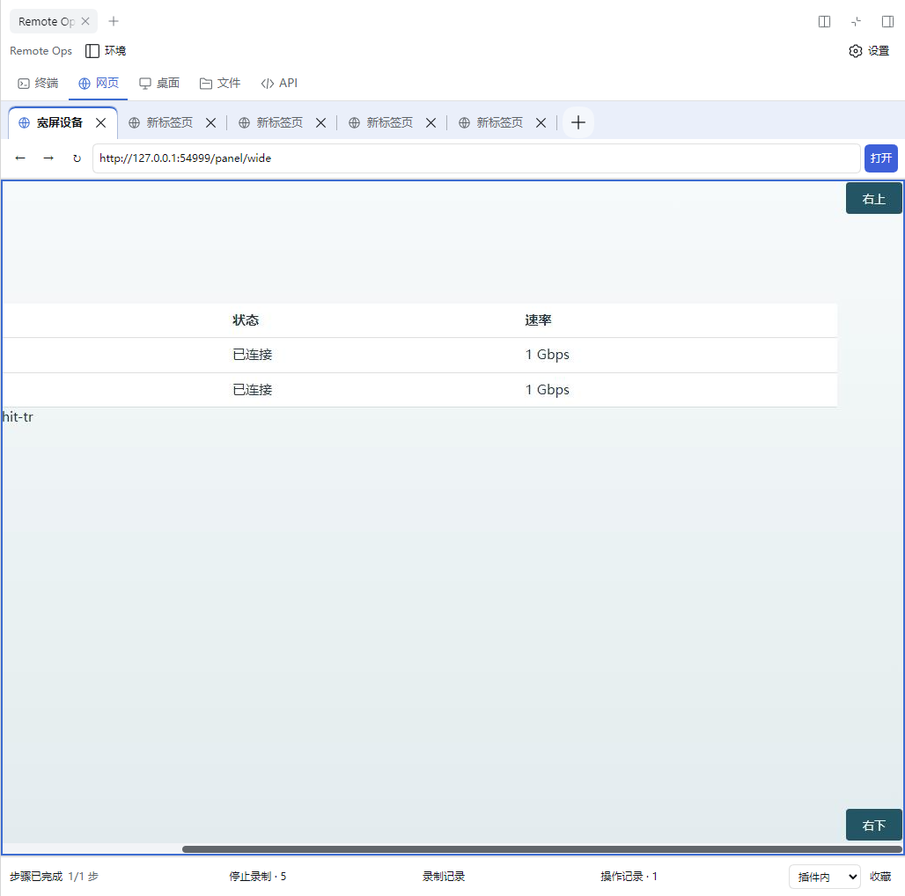

# Remote Ops v0.15.11 嵌入网页验收

2026-11-16 在 Windows 上将发布候选包安装到独立的 DSH 0.2.1-rc.5 Web 配置。Chrome 打开真实 DSH，插件使用随包 Chromium 访问本地 HTTP 测试站。验收共 14 步，宿主页面未记录 JavaScript 错误。

| 检查 | 实测结果 |
| --- | --- |
| 原始大小 | 宿主分给网页的面板为 1027×768。网页画面宽 1280，底部滚动条高 14，可用高度为 754。DSH 页面本身的横向溢出为 0。 |
| 右侧操作 | 用鼠标拖动底部滚动条至最右端，实际偏移 253。在面板右侧单击后，远端网页显示 `hit-tr`，录制命中按钮 `#tr`，网页坐标为 `(1250, 17)`。 |
| 站点宽度 | 在设置中保存最低宽度 1280。测试页在首次加载时读到 1280，并创建“设备配置”按钮。清空并保存，重新打开时读到 1027。 |
| 手动适应画面 | 拖动真实 DSH 分隔线期间页面持续重排。跨域表单、定宽控制台四角点击、标签切换和宽屏压缩帧的操作均通过。 |
| 自动化回归 | 346 项单元测试、131 项客户端测试、12 项契约测试、11 项桌面测试、插件 smoke、DSH UI 契约检查及两组网页端到端场景通过。单元测试另覆盖站点宽度跨重启保存、协议与端口隔离、后台标签尺寸保留及清空恢复。 |

使用说明见 [网页指南](../../integrations/dsh-remote-ops/WEB.md)。[复验方法](../../e2e/README.md) · [候选包与校验文件摘要](../releases/dsh-remote-ops-v0.15.11.sha256)
