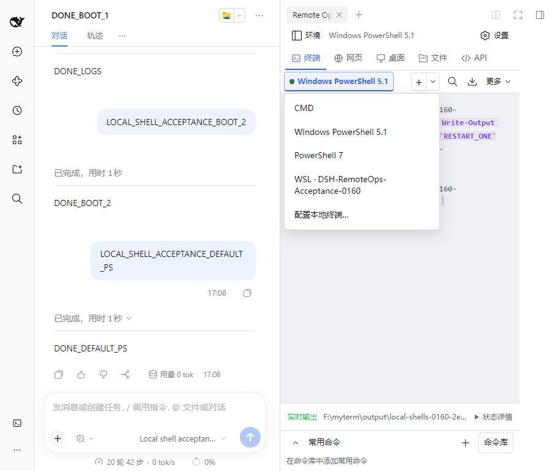

# Remote Ops v0.16.0 本地多终端验收

2026-11-18，在 Windows 的隔离 DSH 0.2.1-rc.5 Web 配置中安装正式候选 tgz，用 Chrome 操作真实插件界面。测试模型夹具通过未修改的 DSH Agent 分发工具调用；命令实际运行于本机 CMD、Windows PowerShell 5.1、PowerShell 7，以及临时导入的 Alpine 3.24.0 WSL 1 发行版。

## 本地终端与界面

7 项宿主验收通过，页面 JavaScript 错误为 0。

| 场景 | 实测结果 |
| --- | --- |
| 单终端启动 | 初次启动仅一个 CMD，加载随包 skill 和枚举 Shell 不增加终端；Agent 默认 open 复用原 ID。 |
| 按需新建 | GUI 下拉菜单逐一打开 PowerShell 5.1、PowerShell 7 和 WSL，每次只增加一个标签。Agent 请求相同配置时复用精确 sessionId。 |
| 真实执行 | 四种 Shell 均产生中文回显；Windows 文件实际写入含中文及空格的测试路径。独立命令均读取到真实退出码 7；两个 PowerShell 的临时变量互不串用。 |
| 人工输入 | 点击 + 只新增一个默认 CMD，人工输入出现在新终端，旧默认会话没有该命令。 |
| 退出与关闭 | exit 后保留灰色标签及最后输出，显式重开后 streamId 改变。Agent 关闭额外本地终端后标签消失，回到默认终端；归档日志仍可导出。 |
| 日志 | 随包日志 skill 可加载，Agent 通过插件接口导出 ZIP。浏览器实际下载文件，SHA256 与工具回执一致，包含各 Shell 和已关闭终端记录。 |
| 默认配置与窄栏 | 保存默认 PowerShell 及含空格目录不会替换已有会话；完整重启后仅一个 PowerShell，目录正确。390px 插件面板中菜单、+ 和标签可操作。 |

WSL 2、其他发行版及用户自己的 Shell 启动配置未做本轮实机验证。PowerShell 7 和 WSL 使用 DSH 主机上的安装，不随插件安装。临时 WSL 发行版已移除；隔离测试安装副本的批量清理被自动审批拦截，因此测试副本、回执和截图暂时保留在本机独立验收目录。



## 热加载

从 v0.15.12 的隔离安装迁移至候选包，再用测试专用的后续版本验证热加载。额外 CMD、PowerShell 5.1、PowerShell 7、WSL 和 SSH 均保留 sessionId 与 streamId，新运行版本仍可继续下发命令。进行中的 API 请求和批量上传会阻止提前重载；对话草稿、网页输入与 API 登录保留。宿主配置重组后运行版本仍正确，故意启动失败的候选版本可回退，SSH 连接计数没有增加。

合成后续版本仅用于测试，不发布。普通终端验收和热加载均使用下方 SHA256 记录中的同一候选包。

## 回归与打包

- `npm run check --prefix integrations/dsh-remote-ops`：359 项单元、132 项客户端、12 项契约、11 项桌面测试及 smoke 通过。
- 真实客户端、插件后端和测试设备组成的浏览器场景通过 25/25；终端界面收尾后相关场景再次通过 5/5。
- 新增回归覆盖并发 open 复用、无 Agent 的 HTTP 操作、精确输入/读取/信号路由、日志隔离、关闭与重开互斥、WSL UTF-16 枚举、参数校验和不同 Shell 的启动参数。
- DSH UI 契约：14 项通过；唯一提示是项目不是 Codex 插件，没有 `.codex-plugin/plugin.json`。
- tgz 的 86 个客户端、服务端、README、随包 skill 与对应源码逐字节一致。包含原有 Windows/Linux 浏览器运行时，不含测试凭据、测试安装目录或 node_modules。

发布仅包含 tgz 和 SHA256 校验文件，摘要见 [发布包校验记录](../releases/dsh-remote-ops-v0.16.0.sha256)。

## 复验

```powershell
$env:DSH_CLI = '已安装 DSH 的 lib\bin.js 绝对路径'
$env:LOCAL_SHELL_OUTPUT = '独立测试输出目录'
$env:LOCAL_WSL_DISTRIBUTION = '已安装且允许写入测试文件的发行版名'
node e2e/runner/local-terminal-native.mjs dist-release/myterm-v0.16.0/dsh-remote-ops-v0.16.0.tgz
```

脚本在独立 DSH_HOME 中安装插件，使用本地模型夹具，不读取日常 DSH 的登录配置。WSL 测试在指定发行版的 `/tmp/dsh-remote-ops-0160.txt` 写入固定测试内容；未设置发行版时会明确记录 WSL 未测试。四种实际 Shell 的验收截图和 JSON 回执在所指定的输出目录中。
