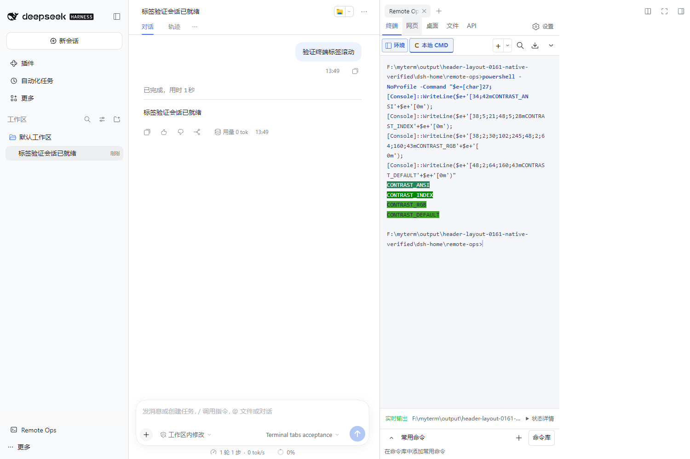

# Remote Ops v0.16.1 布局与终端配色验收

2026-11-20，在 Windows 的独立 DSH 0.2.1-rc.5 Web 配置中安装候选包，以 Chrome 158.0.8127.36 操作真实宿主。没有安装到日常 Desktop profile，也没有修改 Agent。

## 真实 DSH

17 项验收通过，页面 JavaScript 错误为 0。CMD 命令在本机实际执行；SSH 连接使用本地隔离测试服务，不代表生产设备验收。

| 场景 | 结果 |
| --- | --- |
| 两行导航 | 640px、390px 插件宽度下，五个工作区与设置同栏，环境按钮独立于终端标签；顶部导航 39px、终端栏 43px，无横向页面溢出。 |
| 环境往返 | 五个工作区均能进入环境管理，左上角“返回”恢复入口焦点；切换工作区保留终端输出。 |
| 配色 | 实际 CMD 调用 PowerShell 输出 ANSI 标准色、256 色、真彩色和仅设置背景的样例；深浅主题均达到至少 4.5:1。关闭保护可看到原始低对比组合，文本不变。 |
| 多终端 | 启动仅一个 CMD。连接 12 个 SSH 测试环境后左右按钮可遍历标签，后台输出不抢回滚动位置；Home/End、连续点击、390px、深色及减少动画通过。 |
| 状态保留 | 关闭活动标签后保持可见选中项；切换原生对话后，其他对话的连接与草稿保留。 |
| 环境管理 | 分组折叠、搜索、编辑返回、批量删除确认与取消、API 环境使用后返回请求工作区、390px 控件可见均通过。 |



本轮没有连接内网生产设备，也未重验 Windows 远程桌面、其他宿主版本、PowerShell 7 或 WSL。热加载后端未改动，本轮没有重新执行完整更新链路验收。

## 回归和包校验

- `npm run check --prefix integrations/dsh-remote-ops`：359 项单元、136 项客户端、12 项契约、11 项桌面测试及 smoke 通过。
- 新增对比度与导航回归先在旧实现上失败，再由修改后的实现通过。覆盖前景／背景默认值、语义命令、状态文字、关闭保护和不修改原样式对象。
- 真实浏览器运行生产客户端与插件后端：新增布局、环境抽屉、终端配色与日志、统一设置／后台徽标／API JSON 树，共 4 个相关场景通过；覆盖实际 TXT／ZIP 下载和文本一致性。
- DSH UI 契约检查 14 项通过，0 错误。仅提示本项目不是 Codex 插件，没有 `.codex-plugin/plugin.json`。
- tgz 中 98 个源码、说明及 skill 文件与本地候选源码逐字节一致，不含测试目录、凭据或 node_modules。随包运行时沿用已有打包方式。
- 发布使用实际安装验收的同一 tgz，摘要固定在[发布包校验记录](../releases/dsh-remote-ops-v0.16.1.sha256)，仅提供 tgz 和 SHA256。

## 复验

```powershell
$env:DSH_CLI = '已安装 DSH 的 lib\bin.js 绝对路径'
$env:TERMINAL_TABS_OUTPUT = '新的独立验收目录'
node e2e/runner/terminal-tabs-native.mjs dist-release/dsh-remote-ops-v0.16.1.tgz
```

脚本创建独立 DSH_HOME、本地模型应答夹具与 SSH 测试服务，不读取日常配置。证据包括 `evidence.json`、深浅配色截图和逐步截图。本次本地证据位于 `output/header-layout-0161-native-verified/`；失败尝试及修正后的回执分别保留，发布以最终通过记录为准。
