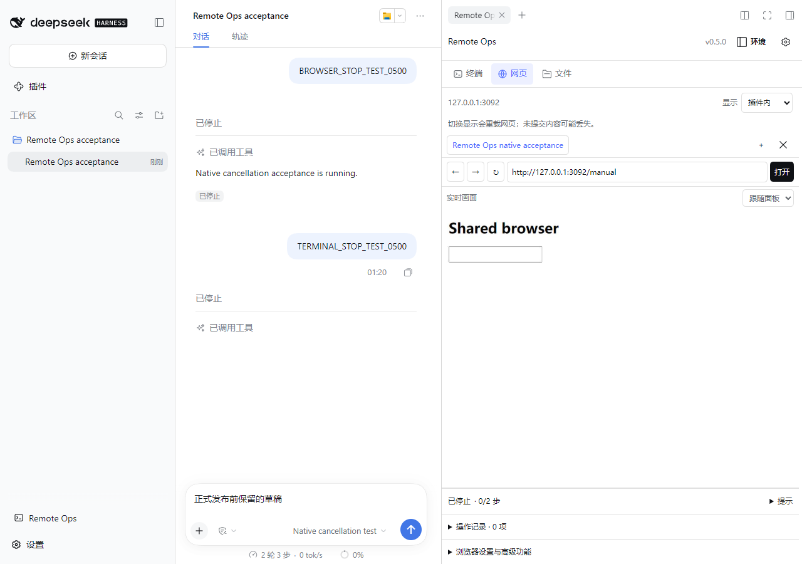
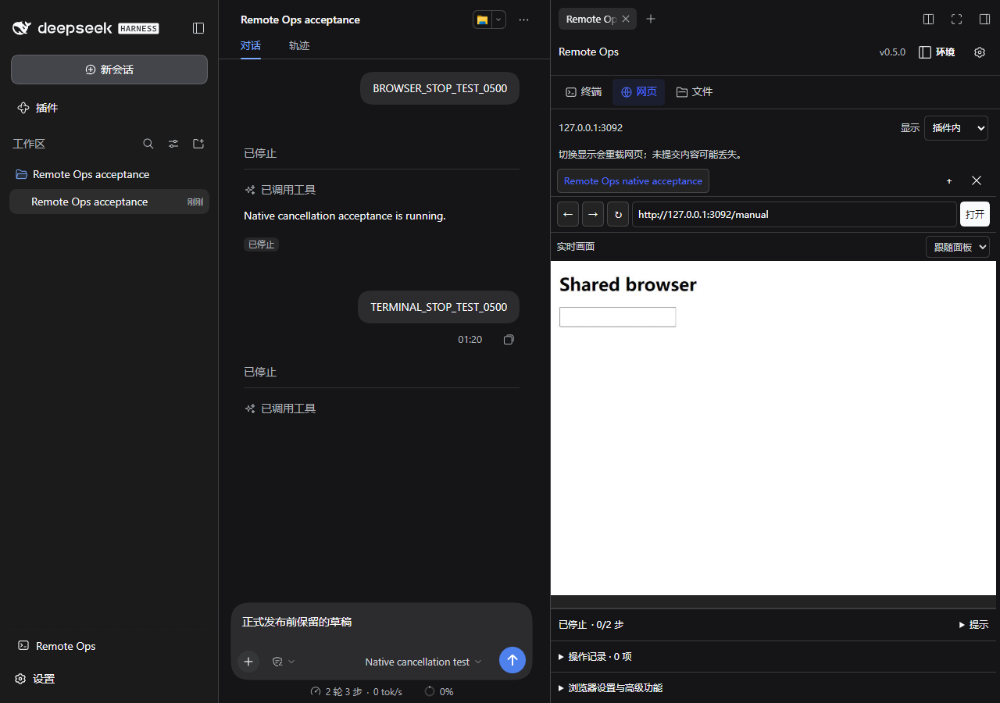

# dsh-remote-ops v0.5.0 验收

验证日期：2026-10-15（Asia/Tokyo）。本次按“终端 / 网页 / 文件”工作区标签方案实现全部模块样式与交互优化。

## 自动化门禁

| 层级 | 命令 / 环境 | 结果 |
| --- | --- | --- |
| 语法、后端、前端、契约、smoke | `npm run check --prefix integrations/dsh-remote-ops`，Windows / Node 24.11.1 | 163 后端、103 前端、11 契约测试及 smoke 全通过 |
| DSH UI 静态契约 | `check_dsh_ui_contract.mjs integrations/dsh-remote-ops` | 14 通过、0 错误；1 个预期警告为 DSH 包没有 Codex manifest |
| 浏览器回归 | `node e2e/runner/index.mjs --output output/workspace0500-e2e-ship`，Chrome 154.0.8037.99 | 12/12；真实插件和 client.js，仿宿主、假 SSH/SFTP 设备及本地测试站点 |
| 候选包真实宿主 | 隔离 `DSH_HOME`，DSH 0.2.0-rc.2 Web，Chrome，1280×900 与 390×844 | 下述 9 组流程全通过，无 console/pageerror 或 HTTP 错误 |
| 宿主禁用、重新启用 | 真实 DSH 插件管理器 | 禁用后入口消失；重新启用后只有 1 个入口、1 个右栏标签、1 份样式，无控制台错误 |

新增回归先复现再修复了两处竞态：切回网页时状态尚未读回就改变显示方式，以及进入文件夹碰上排队刷新后地址栏停留在旧路径。前者等待当前浏览器状态后再允许操作，失败可重试；后者在导航时立即更新路径，同时保留真正未提交的路径编辑。

## 真实 DSH 流程

1. 左侧展开入口为 `flex-start`、图标内缩 10px；收起后只显示图标，Enter 可打开。重复点击只有一个原生右栏标签，关闭重开后主对话编辑器 DOM 与草稿保留；工作区方向键及 Home 可用。
2. 本地 CMD 人工输入可见。独立命令运行时关闭弹窗、进入文件页并整页刷新，仍可读取退出码 0 与 `NATIVE_BACKGROUND_0500`；Tab、Esc、返回入口焦点通过。
3. 环境分组在面板内输入且 Esc 取消；快捷命令分组可保存；诊断预览弹窗可关闭。
4. 真实 DSH 主机目录筛选、Shift 批选、切页保留选择、Enter 进入文件夹及地址更新通过。
5. 输入本地测试网址打开嵌入网页；视口跟随面板，人工点击及中文输入可见。
6. 本地确定性模型经真实 DSH 调用 `remote_browser_run`。Agent 等待时仍可人工输入；原生“停止生成”约 155ms 使等待停止，第二步未执行。
7. 同一模型经真实 DSH 调用 `remote_terminal_send`。等待期间人工输入可见；原生“停止生成”约 65ms 取消等待。
8. 插件内与独立 Chrome 窗口之间切换，网页重新载入，主对话 DOM 和草稿保留；刷新后恢复网页工作区与当前浏览器。
9. 浅色、系统深色、减少动态效果、390px 下三个工作区无横向溢出；嵌入网页视口与面板宽度相符且可见。

模型与网页均为本地测试夹具；模型固定发出真实工具调用，用于验证 DSH 工具派发和停止链路，不代表任意真实模型或第三方网站的行为。测试浏览器是实际 Chrome；SSH/SFTP 设备场景仍是仿设备。

## 性能小样

- 仿宿主渲染 1000 个文件，连续切换 20 次：首轮 p95 约 402ms；文件页保留、隐藏时暂停轮询后，最终回归 p95 约 **90ms**。这是本机前端交互测量，不是 SSH 或网络延迟保证。
- `node integrations/dsh-remote-ops/test/benchmark-ui.mjs`：262144 字节 ASCII 日志解析中位数从 v0.4.0 的 29.36ms 降至 0.90ms，SGR 日志从 28.62ms 降至 1.07ms；屏幕与光标结果与原 VT 路径一致。只测解析，不代表完整渲染耗时。Unicode、光标控制等仍走完整 VT 路径。

## 界面记录

以下为正式 Release 包全新安装后的真实 DSH 截图，网页内容来自本地测试站点：

[390px 网页](assets/dsh-remote-ops-v0.5.0/narrow.png) · [终端](assets/dsh-remote-ops-v0.5.0/terminal.png) · [文件](assets/dsh-remote-ops-v0.5.0/files.png)

## 发布包核验

正式 [GitHub Release](https://github.com/Ssshake1996/myterm/releases/tag/dsh-remote-ops-v0.5.0) 已发布，tag 对应提交 `4c6d76fcd164473521e2ccebc26cc2b7ed58b4cd`；[Linux / Node 22 发布工作流](https://github.com/Ssshake1996/myterm/actions/runs/38596868495) 完整通过。

- 重新下载正式 `dsh-remote-ops-v0.5.0.tgz` 和校验文件，SHA256 与本地发布包、GitHub 资产 digest 均一致：`8aef8d04c1aba8d3b19ceb956814e296bae8ec6b1b25a8be73318614224ed9d3`。
- 包内 **45 个文件**逐一与当前源码及全新安装目录匹配，包版本为 `0.5.0`。
- 正式资产安装到另一个新建、隔离的 `DSH_HOME` / `web` profile，并启动实际 DSH 0.2.0-rc.2；以上 **9 组流程再次全部通过**，无 console/pageerror 或 HTTP 错误。
- 正式包复验中，网页原生停止约 **187ms**、终端等待取消约 **57ms**；人工输入可用，网页下一步未执行。该数值为本机一次验收观察，不是延迟保证。
- 测试 profile 使用本地模型和站点夹具；日常 DSH profile 未被覆盖。测试服务和浏览器在验收后关闭，保留隔离目录与证据文件。

## 已知边界

- 未验证真实远端 SSH/SFTP 设备、另一台电脑、其他 DSH 版本或任意第三方登录网站。正式 CI 运行 Linux 自动化门禁，不等于 Linux 桌面交互验收。
- 不新增接管、暂停、停止按钮或对应 Agent 工具；人和 Agent 始终共享输入。停止使用 DSH 主对话，已发出的操作不回滚。
- 后台任务不跨插件卸载或 DSH 重启恢复；浏览器上传不提供整页刷新后的断点续传。独立命令结果只在进程内有界保留，命令正文不跨整页刷新保存。
- SSH 参数空格问题已按用户要求暂缓，本版本未声称修复。
